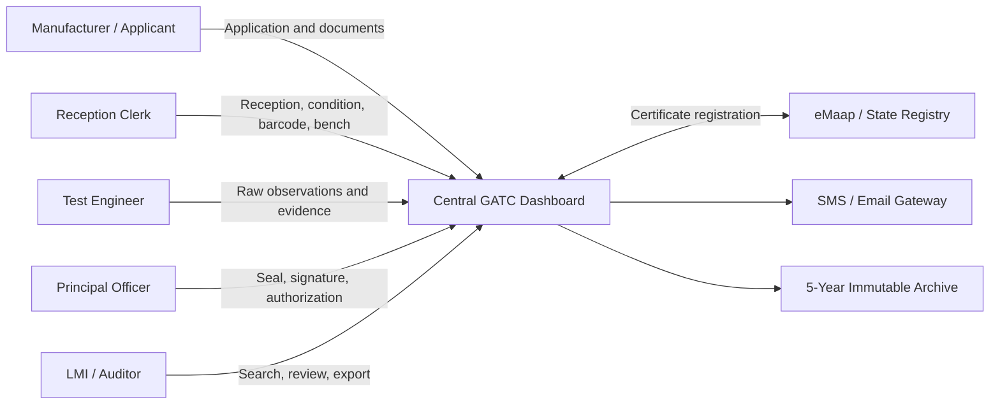
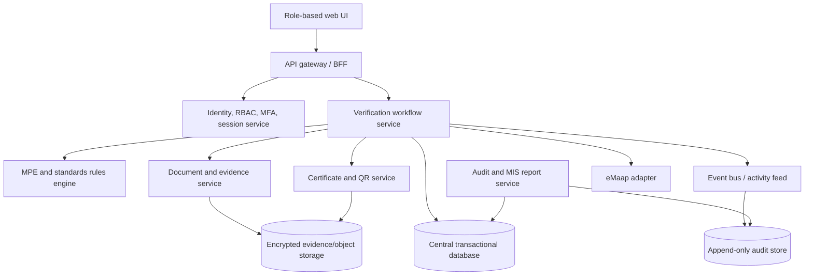
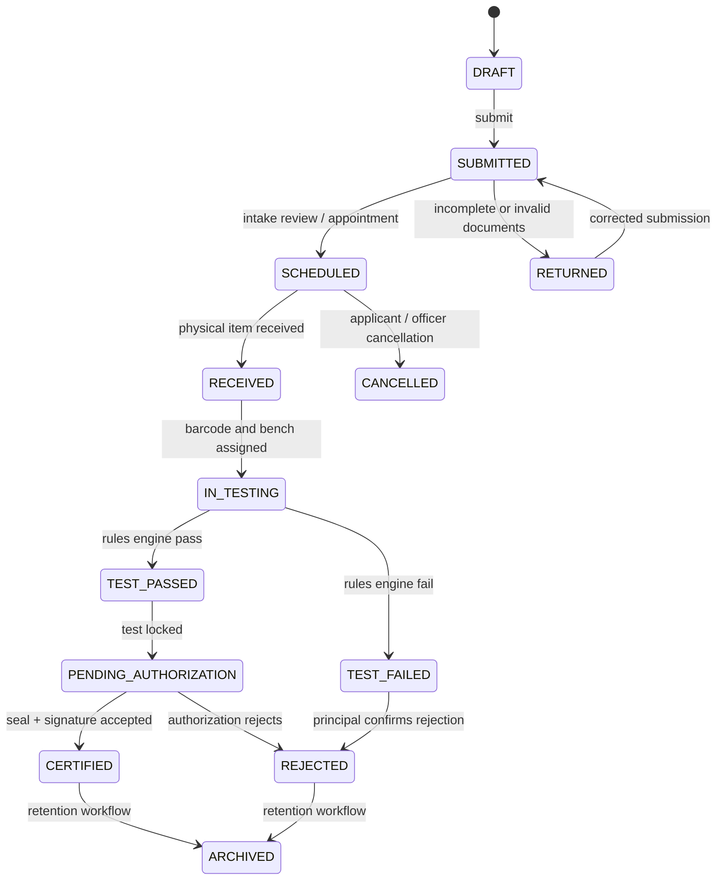
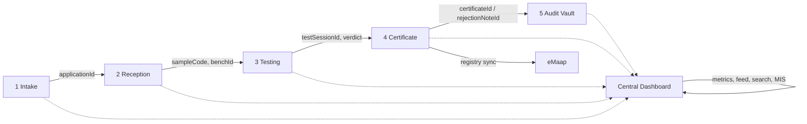

# GATC Legal Metrology Verification Portal

## 1. Purpose and Design Principles

The GATC portal is a centralized, audit-ready workflow for receiving, testing, stamping, certifying, rejecting, and archiving weights, measures, and load cells. It is designed to integrate with state or central platforms such as eMaap while remaining usable as a standalone GATC operational system.

### Non-negotiable principles

- **One source of truth:** every page reads and writes the same application aggregate through the Central GATC Dashboard service.
- **Traceable state changes:** every mutation creates an immutable audit event with actor, timestamp, source page, previous state, next state, and correlation ID.
- **Server-authoritative status:** the browser never decides whether an item is certified; it submits evidence and receives an authorized transition.
- **Evidence before outcome:** raw readings, standards, seals, signatures, and rejection reasons are retained with the record that produced them.
- **Least privilege:** manufacturer, reception clerk, test engineer, principal officer, LMI, and auditor receive separate capabilities.
- **Accessible field use:** keyboard access, high contrast, large touch targets, visible focus, short forms, and printable/exportable records are required.

## 2. System Context



## 3. Central Architecture



### Recommended deployment boundaries

| Boundary | Responsibility | Availability / control |
|---|---|---|
| Web client | Role-specific forms, queue views, validation hints, offline-safe draft handling | No authoritative business decisions in client code |
| API gateway | Authentication, request validation, correlation ID, rate limiting | TLS, CSRF protection, structured errors |
| Workflow service | State machine, assignment, SLA timers, idempotency, authorization | Only service allowed to mutate verification state |
| Rules engine | Versioned Legal Metrology MPE and standard validity rules | Rule version stored with every test result |
| Transactional database | Current application, intake, tests, certificate, fee records | ACID transactions and foreign-key integrity |
| Evidence store | Photos, approvals, signed PDFs, uploaded certificates | Encryption, malware scan, retention lock |
| Audit store | Append-only activity and access events | WORM/immutable retention for at least five years |
| eMaap adapter | Registry synchronization and reconciliation | Retry queue, idempotency key, failure dashboard |

## 4. Page Map and Routes

| Page | Route | Primary roles | Reads | Writes | Completion event |
|---|---|---|---|---|---|
| Central Dashboard | `/gatc/dashboard` | GATC manager, principal officer | All aggregates, metrics, feed, SLA | Assignment, escalation, report request | `DashboardViewed`, `ReportRequested` |
| Application Intake | `/gatc/applications/new` | Applicant, intake clerk | Categories, fee table | Application, documents, appointment | `ApplicationSubmitted` |
| Application Detail | `/gatc/applications/:applicationId` | All permitted roles | Complete application timeline | Notes, assignment, reschedule | `ApplicationUpdated` |
| Reception & Barcode | `/gatc/reception` | Reception clerk | Scheduled applications | Reception result, sample code, bench | `EquipmentReceived` |
| Testing Queue | `/gatc/testing` | Test engineer | In-lab samples, standards | Test session, observations, evidence | `TestSessionStarted` |
| Testing Workbench | `/gatc/testing/:sampleCode` | Test engineer | Sample, rules, standards | Readings, MPE verdict, evidence | `TestCompleted` |
| Stamping & Certificate | `/gatc/certificates/pending` | Principal officer | Passed tests, fees, seal inventory | Seal, signature, certificate/rejection | `CertificateIssued` or `ApplicationRejected` |
| Audit Vault | `/gatc/audit` | LMI, auditor | All current and archived records | Saved filters, export request | `AuditExported` |
| Public Verify | `/verify-certificate` | Public | Published certificate only | Verification query and access log | `CertificateVerified` |

### Route guard matrix

| Capability | Applicant | Clerk | Engineer | Principal | LMI/Auditor | Manager |
|---|---:|---:|---:|---:|---:|---:|
| Submit application | CRUD own | CRUD intake | Read | Read | Read | Read |
| Receive/barcode | - | CRUD | Read | Read | Read | Read |
| Enter test readings | - | - | CRUD assigned | Read | Read | Read |
| Approve certificate | - | - | - | CRUD | Read | CRUD |
| Reject with reason | - | - | Propose | CRUD | Read | CRUD |
| Export audit record | Own | - | - | - | CRUD | CRUD |
| Manage standards/rules | - | - | Read | Approve | Read | CRUD |

## 5. End-to-End State Machine



Every transition must validate the current version of the record, reject stale updates with `409 CONFLICT`, and append an audit event. A transition is idempotent when retried with the same `Idempotency-Key`.

## 6. Data Flow



### Event contract

```json
{
  "eventId": "evt_01J8GATC...",
  "eventType": "TestCompleted",
  "occurredAt": "2026-09-14T10:30:00Z",
  "actor": { "userId": "eng-1024", "role": "TEST_ENGINEER" },
  "aggregate": { "type": "VerificationApplication", "id": "GATC-APP-2026-000901", "version": 8 },
  "correlationId": "corr_01J8...",
  "payload": { "verdict": "PASS", "testSessionId": "GATC-TST-2026-000331" }
}
```

## 7. Core JSON Schemas

### 7.1 Application Record

```json
{
  "$schema": "https://json-schema.org/draft/2020-12/schema",
  "$id": "https://gatc.example.gov/schemas/application-record.json",
  "title": "ApplicationRecord",
  "type": "object",
  "required": ["applicationId", "applicant", "instrument", "verificationType", "status", "submittedAt", "audit"],
  "properties": {
    "applicationId": { "type": "string", "pattern": "^GATC-APP-[0-9]{4}-[0-9]{6}$" },
    "applicant": {
      "type": "object",
      "required": ["manufacturerName", "contactName", "phone", "email"],
      "properties": {
        "manufacturerName": { "type": "string", "minLength": 2 },
        "contactName": { "type": "string", "minLength": 2 },
        "phone": { "type": "string" },
        "email": { "type": "string", "format": "email" },
        "address": { "type": "string" }
      }
    },
    "modelApprovalCertificateNumber": { "type": "string" },
    "instrument": {
      "type": "object",
      "required": ["category", "model", "serialNumbers"],
      "properties": {
        "category": { "type": "string", "enum": ["I", "II", "III", "IV"] },
        "model": { "type": "string" },
        "serialNumbers": { "type": "array", "items": { "type": "string" }, "minItems": 1 },
        "capacity": { "type": "string" },
        "scaleInterval": { "type": "string" }
      }
    },
    "verificationType": { "type": "string", "enum": ["INITIAL", "PERIODIC", "POST_REPAIR"] },
    "status": { "type": "string", "enum": ["DRAFT", "SUBMITTED", "SCHEDULED", "RECEIVED", "IN_TESTING", "TEST_PASSED", "TEST_FAILED", "PENDING_AUTHORIZATION", "CERTIFIED", "REJECTED", "ARCHIVED", "RETURNED", "CANCELLED"] },
    "appointment": { "type": ["object", "null"], "properties": { "scheduledAt": { "type": "string", "format": "date-time" }, "assignedOfficerId": { "type": "string" } } },
    "sample": { "type": ["object", "null"], "properties": { "sampleCode": { "type": "string" }, "benchId": { "type": "string" }, "receivedAt": { "type": "string", "format": "date-time" } } },
    "sla": { "type": "object", "properties": { "dueAt": { "type": "string", "format": "date-time" }, "paused": { "type": "boolean" }, "elapsedHours": { "type": "number" } } },
    "fees": { "type": "object", "properties": { "amount": { "type": "number", "minimum": 0 }, "currency": { "type": "string", "const": "INR" }, "paymentStatus": { "type": "string", "enum": ["PENDING", "PAID", "WAIVED", "REFUNDED"] } } },
    "submittedAt": { "type": "string", "format": "date-time" },
    "audit": { "type": "object", "required": ["createdBy", "createdAt", "updatedAt", "version"], "properties": { "createdBy": { "type": "string" }, "createdAt": { "type": "string", "format": "date-time" }, "updatedAt": { "type": "string", "format": "date-time" }, "version": { "type": "integer", "minimum": 1 } } }
  }
}
```

### 7.2 Test Observation Log

```json
{
  "$schema": "https://json-schema.org/draft/2020-12/schema",
  "$id": "https://gatc.example.gov/schemas/test-observation-log.json",
  "title": "TestObservationLog",
  "type": "object",
  "required": ["testSessionId", "applicationId", "standard", "readings", "verdict", "performedBy", "startedAt", "completedAt"],
  "properties": {
    "testSessionId": { "type": "string", "pattern": "^GATC-TST-[0-9]{4}-[0-9]{6}$" },
    "applicationId": { "type": "string" },
    "standard": { "type": "object", "required": ["calibrationId", "validUntil"], "properties": { "calibrationId": { "type": "string" }, "validUntil": { "type": "string", "format": "date" }, "statusAtTest": { "type": "string", "enum": ["VALID", "EXPIRED", "UNKNOWN"] } } },
    "readings": { "type": "object", "required": ["maxCapacity", "minCapacity", "scaleInterval", "numberOfIntervals"], "properties": { "maxCapacity": { "type": "number", "minimum": 0 }, "minCapacity": { "type": "number", "minimum": 0 }, "scaleInterval": { "type": "number", "exclusiveMinimum": 0 }, "numberOfIntervals": { "type": "integer", "minimum": 1 }, "eccentricity": { "type": "array", "items": { "type": "number" } }, "repeatability": { "type": "array", "items": { "type": "number" } } } },
    "mpe": { "type": "object", "required": ["ruleVersion", "allowedError", "observedError"], "properties": { "ruleVersion": { "type": "string" }, "allowedError": { "type": "number" }, "observedError": { "type": "number" }, "withinLimit": { "type": "boolean" } } },
    "verdict": { "type": "string", "enum": ["PASS", "FAIL", "INCOMPLETE"] },
    "evidenceDocumentIds": { "type": "array", "items": { "type": "string" } },
    "performedBy": { "type": "string" },
    "startedAt": { "type": "string", "format": "date-time" },
    "completedAt": { "type": "string", "format": "date-time" }
  }
}
```

### 7.3 Certificate Record

```json
{
  "$schema": "https://json-schema.org/draft/2020-12/schema",
  "$id": "https://gatc.example.gov/schemas/certificate-record.json",
  "title": "CertificateRecord",
  "type": "object",
  "required": ["certificateId", "applicationId", "outcome", "issuedAt", "authorizedBy", "verification"],
  "properties": {
    "certificateId": { "type": "string", "pattern": "^GATC-CERT-[0-9]{4}-[0-9]{6}$" },
    "applicationId": { "type": "string" },
    "sampleCode": { "type": "string" },
    "outcome": { "type": "string", "enum": ["CERTIFIED", "REJECTED"] },
    "hologramSealId": { "type": ["string", "null"] },
    "securityStampSerial": { "type": ["string", "null"] },
    "rejectionReason": { "type": ["string", "null"] },
    "documentId": { "type": "string" },
    "issuedAt": { "type": "string", "format": "date-time" },
    "validUntil": { "type": ["string", "null"], "format": "date" },
    "authorizedBy": { "type": "string" },
    "signatureReference": { "type": "string" },
    "registry": { "type": "object", "properties": { "provider": { "type": "string", "const": "eMaap" }, "externalId": { "type": "string" }, "syncStatus": { "type": "string", "enum": ["PENDING", "SYNCED", "FAILED"] }, "lastAttemptAt": { "type": "string", "format": "date-time" } } },
    "verification": { "type": "object", "required": ["qrToken", "publicUrl"], "properties": { "qrToken": { "type": "string" }, "publicUrl": { "type": "string", "format": "uri" } } }
  }
}
```

## 8. Dashboard Information Architecture

### Global shell

```text
+--------------------------------------------------------------------------------+
| GATC Portal | Universal Search [Application / Hologram / Manufacturer] | User |
+----------------------+---------------------------------------------------------+
| Dashboard            | Page title                         [Export] [New intake] |
| Application Intake   |---------------------------------------------------------|
| Reception & Barcode  | KPI: Received | Testing | Passed | Rejected | SLA | Fees |
| Testing Workbench    |---------------------------------------------------------|
| Certificates         | Activity feed                    | SLA exceptions        |
| Audit Vault          |                                    |                        |
| Standards & Rules    | Central queue / current workflow records                  |
| Settings             |                                    |                        |
+----------------------+---------------------------------------------------------+
```

### Central Dashboard wireframe

| Region | Component | Required behavior |
|---|---|---|
| Header | Navy shell, GATC identity, role badge, universal search | Search by application ID, hologram number, manufacturer; keyboard accessible |
| KPI row | Six metric tiles: Total Received, In-Testing, Passed, Rejected, Average SLA, Fees Collected | Values come from server-side aggregate query; include comparison period and timestamp |
| Queue | Filterable master table | Status, manufacturer, sample code, bench, assigned engineer, SLA remaining, last event |
| Activity | Chronological event feed | Newest first; actor, action, record link, event time; live refresh via SSE/WebSocket |
| Exceptions | SLA breaches, expired standards, failed eMaap sync, pending authorization | Severity badge and direct remediation action |
| Reports | Weekly/monthly MIS generator | Date range, status/category filters, CSV/PDF, export audit event |

### Theme tokens

| Token | Value | Use |
|---|---|---|
| `--gatc-navy` | `#1e3a8a` | Navigation, primary actions, headings |
| `--gatc-slate` | `#475569` | Secondary text, borders, metadata |
| `--gatc-emerald` | `#10b981` | Pass, synced, completed |
| `--gatc-amber` | `#f59e0b` | Warnings, due soon, pending |
| `--gatc-red` | `#dc2626` | Rejection, breach, invalid standard |
| `--gatc-surface` | `#f8fafc` | Page background and table surfaces |

Use Inter when provisioned by the host application, with `system-ui` fallback. Do not communicate status by color alone: pair every color with text and an icon or symbol.

## 9. API and Integration Contract

| Method | Endpoint | Purpose |
|---|---|---|
| `POST` | `/api/v1/applications` | Create application and return application reference |
| `GET` | `/api/v1/dashboard/summary` | KPI aggregates and SLA counters |
| `GET` | `/api/v1/dashboard/activity` | Cursor-paginated activity feed |
| `GET` | `/api/v1/applications?query=` | Universal search and filters |
| `POST` | `/api/v1/applications/{id}/reception` | Receive, inspect, barcode, assign bench |
| `POST` | `/api/v1/applications/{id}/tests` | Lock a test observation log and calculate verdict |
| `POST` | `/api/v1/applications/{id}/certificate` | Authorize certificate or rejection note |
| `GET` | `/api/v1/certificates/{id}/verify` | Public certificate verification |
| `GET` | `/api/v1/audit/export` | Generate signed CSV/PDF audit export |
| `POST` | `/api/v1/registry/emapp/sync` | Retry or reconcile eMaap registration |

All write endpoints require an authenticated role, `Idempotency-Key`, `X-Correlation-ID`, optimistic version, and a machine-readable error response. Dates are ISO 8601 UTC; money is integer paise in storage and formatted as INR in the UI.

## 10. SLA, Audit, Security, and Retention

- Start the 15-day completion SLA at `EquipmentReceived`, pause only for a recorded applicant dependency, and resume with a new audit event.
- Store both `dueAt` and calculated elapsed business hours so reports remain reproducible if calendars change.
- Prevent editing of locked test observations; corrections create a superseding observation and reason.
- Retain application, test, certificate, rejection, fee, registry, access, and export events for at least five years; legal policy may extend this period.
- Encrypt data in transit and at rest. Scan uploaded files before attaching them to an application.
- Use MFA for principal officers and auditors, immutable audit storage, periodic access review, and server-side authorization on every record request.
- Redact personal contact data from public certificate verification; expose only the minimum certificate and instrument details required for authenticity checking.

## 11. Implementation Sequence

1. Replace the GATC static row with the Central Dashboard shell and shared application query.
2. Extend the storage/API contract with application, reception, test, certificate, fee, standard, and audit collections/tables.
3. Implement the state machine and audit event writer before adding page forms.
4. Build intake and reception, then testing workbench with versioned MPE rules.
5. Add principal-officer authorization, PDF/QR generation, and eMaap retry/reconciliation.
6. Add the five-year audit vault, exports, accessibility checks, and operational monitoring.
7. Test each transition with duplicate submissions, stale versions, expired standards, failed uploads, registry outages, and unauthorized roles.

The existing prototype can use these same aggregate names in `localStorage` for a demo, but production deployment should move all authoritative writes and audit retention behind the API and database boundaries above.
